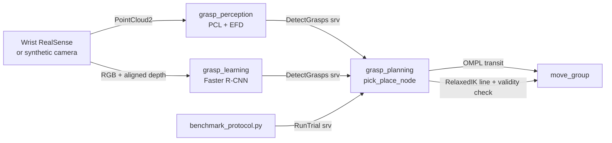

# Franka Pick and Place: Top-Surface vs. Learned Grasping

A ROS 2 (Humble) + MoveIt 2 pipeline for picking unknown objects with a Franka Emika Panda
and an eye-in-hand RGB-D camera. It contains two grasp detectors and the benchmarking
protocol used to compare them:

- **Classical (Top Surface)**: PCL segmentation, top-surface outline, Elliptical Fourier
  Descriptors, then a search for a friction-cone contact pair.
- **Learned**: multi-grasp Faster R-CNN (ResNet-50, grasp angle as a class, RGD input),
  trained on the Cornell dataset.
- **Motion**: OMPL (RRTConnect / PRM) transit plus a RelaxedIK-style straight-line approach,
  with collision checks against the MoveIt planning scene.
- **Evaluation**: the lab's protocol: 10 YCB objects × 6 placements × 3 trials, with lift,
  yaw and shake stages, scored as Grasp Score (GS) and Grasp Success Score (GSS).

> Re-implementation of the pick-and-place half of a project done at the Manipulation &
> Environmental Robotics Lab (WPI). The evaluation follows Rameshbabu et al., *A Benchmarking
> Study of Vision-based Robotic Grasping Algorithms* (IEEE RAM, arXiv:2503.11163), and the
> protocol of Bekiroglu et al. (RA-L 2019).



## Packages

| Package | Language | What it does |
|---|---|---|
| `relaxed_ik_lite` | C++ (Eigen only) | Panda FK/Jacobian and a RelaxedIK-style IK: groove-loss objectives (pose, joint velocity/acceleration/jerk, joint limits) solved with projected BFGS. `solveGoal` for one-shot goals, `trackLine` for smooth straight-line motions. |
| `grasp_perception` | C++ (PCL, OpenCV) | Classical detector. Steps: crop, voxel grid, outlier removal, RANSAC table plane, Euclidean clusters, top 2 cm layer, outline, EFD fit, friction-cone pair search, then gripper and approach-sweep collision checks against the cloud and table. Offline tool: `detect_grasps_pcd`. |
| `grasp_learning` | Python (PyTorch) | Learned detector: Chu et al. (2018) architecture in torchvision. Includes Cornell loader, training, rectangle-metric evaluation, and conversion from pixels to 3D grasps. |
| `grasp_planning` | C++ (MoveIt 2) | Pick-and-place state machine, both IK/OMPL modes, the protocol stages, per-attempt CSV logging, and the benchmark driver and report scripts. |
| `grasp_sim` | Python | Ray-cast RGB-D "RealSense" (boxes and cylinders, YCB approximations) that runs the whole pipeline on MoveIt mock hardware with no Gazebo. |
| `grasp_interfaces` | msg/srv | `Grasp`, `DetectGrasps`, `RunTrial`, `SetScene`. |

## Grasp detectors

### Classical: Top Surface + EFD (`grasp_perception`)

1. **Segment** (base frame, z up). Crop to the workspace, apply a 3 mm voxel grid and
   statistical outlier removal. Fit the table with RANSAC, keeping the plane normal within
   8.6° of +z so a large box face cannot win. Split the rest into Euclidean clusters.
2. **Top surface.** Keep the points within 2 cm of each object's top and project them onto
   the table plane. Rasterise at 2 mm, apply morphological closing (this acts like the
   concave hull's alpha) and trace the outer boundary.
3. **EFD** (Kuhl & Giardina) with 20 harmonics. This smooths the pixelated outline and gives
   tangents, outward normals and curvature analytically, instead of by finite differences on
   noisy pixels.
4. **Contact pairs.** Sample 120 points on the curve. For each pair, the line between them must
   lie inside both friction cones (μ = 0.4, so 21.8°), be at most 7.6 cm long, and stay inside
   the outline. The last check rejects pinching across a gap, such as between a clamp's arms.
5. **3D checks.** Place the fingertips as deep as the fingers allow (up to 4 cm below the top
   and above the table). Sweep the opened fingers and palm back along the 10 cm approach and
   reject any that hit the cloud. If the deepest pose collides, back off in 5 mm steps.
6. **Score.** A weighted sum of friction-cone margin, points between the fingers, distance to
   the centroid (torque), curvature at the contacts, width margin and depth. Then non-maximum
   suppression that accounts for the hand's 180° symmetry.

### Learned: multi-grasp Faster R-CNN (`grasp_learning`)

This follows Chu, Xu & Vela, *Real-World Multiobject, Multigrasp Detection* (RA-L 2018):

- **Backbone:** ResNet-50 up to res4 (1024 channels, stride 16).
- **Grasp proposal network:** an RPN that scores "graspable or not" and regresses box deltas.
- **Second stage:** 14×14 RoIAlign, then res5 and a 7×7 average pool (2048 features).
- **`fc 20`:** classifies the orientation into 19 angle bins plus "no grasp".
- **`fc 80`:** regresses the unrotated rectangle for each class.
- **Input:** an RGD image, with depth replacing a colour channel (blue in Chu et al.; the
  benchmarking paper's variant replaces green, set with `--depth-channel 1`).

Rectangles become 3D grasps from the aligned depth. The object top is the 10th percentile of
depth inside the rectangle, and the table is the 90th percentile in a ring around it. The width
is `w_px · depth / fx`. The approach is along the optical axis, so these are 4-DoF top-down
grasps.

```bash
ros2 run grasp_learning train --data ~/datasets/cornell --out frcnn.pt --epochs 20
ros2 run grasp_learning evaluate --data ~/datasets/cornell --model frcnn.pt
```

Both detectors serve `DetectGrasps` with the same message. The planner switches between them
only by service name.

## Motion planning: OMPL + RelaxedIK

Each grasp is planned in one of two ways (parameter `mode`):

| | `ik_goal_ompl` | `ompl_transit_ik_approach` (default) |
|---|---|---|
| Transit to pre-grasp (10 cm back) | OMPL to a RelaxedIK joint goal | OMPL to a RelaxedIK joint goal |
| Pre-grasp → grasp, and lift | OMPL to a RelaxedIK joint goal | RelaxedIK tracks a straight TCP line (5 mm steps); each waypoint is checked with `/check_state_validity` and time-parameterised with TOTG |

**The default is the better design.**

- **Guaranteed straight approach.** The final approach must run straight down the gripper's
  approach axis. The grasp's collision check assumed exactly that sweep. OMPL plans in joint
  space and gives no such guarantee: a random RRTConnect path can swing the fingers into the
  object or its neighbour on the last few centimetres. RelaxedIK's motion terms keep consecutive
  solutions on the same IK branch, so the line is followed smoothly, with no elbow or wrist
  flips.
- **Each tool does its own job.** OMPL handles the long, cluttered free-space move.
  RelaxedIK's speed and smoothness only matter when it streams nearby goals. Mode A uses it as
  plain IK, which wastes those properties.
- **The trade-off:** RelaxedIK has no environment-collision term (CollisionIK adds one), so the
  approach waypoints have to be validated against the planning scene. They are.

Each attempt logs the TCP's maximum deviation from the straight approach line, so this claim
is measured, not assumed. Compare the two with
`ros2 run grasp_planning analyze_benchmark.py /tmp/pick_place_benchmark.csv`.

## Benchmark protocol (Rameshbabu et al. / Bekiroglu et al.)

These settings are taken from the paper and the lab's
[benchmarking code](https://github.com/vinayakkapoor/vision_based_grasping_benchmarking):

- **Objects (YCB):** 056 tennis ball, 044 flat screwdriver, 050/051/052 medium/large/extra-large
  clamp, 011 banana, 012 strawberry, 016 pear, 025 mug, 006 mustard bottle.
- **Placements:** r = 25 cm, θ = 90° around the scan point (0.45, 0):
  - P1 at the centre.
  - P2 at +r along x.
  - P3 and P4 at ±r along y.
  - P5 and P6 at the same positions as P3 and P4, rotated ±θ.
- **Repetitions:** 3 trials, so 180 grasps per configuration.
- **Camera:** looks straight down from 0.8 m (`observe_joints`).
- **Scoring** (paper, Algorithm 1). Each stage only runs if the previous one passed, and each
  passed stage scores 1 point:
  1. Lift to 40 cm and check the object is still held.
  2. Yaw: joint 7 rotated +45°, −90°, +45°.
  3. Shake: joint 5 rotated +22.5°, −45°, +45°, −45°, +22.5°, as in the lab's code. The paper's
     text says "pitching ±45°"; set `protocol.shake_joint` and `protocol.shake_angle` to follow
     the text instead.

  **GSS** is the fraction of trials picked up. **GS** is points scored over 3 × trials.

```bash
# terminal 1: pipeline in trial mode (real robot: sim:=false launch_moveit:=false held_check:=operator)
ros2 launch grasp_planning pick_place.launch.py serve_trials:=true protocol:=true detector:=classical
# terminal 2: drives the 180 trials (simulation places objects; --operator prompts on the real robot)
ros2 run grasp_planning benchmark_protocol.py --algorithm top_surface_efd --config sim --sim --out results/efd_sim.csv
ros2 run grasp_planning protocol_report.py results/*.csv --markdown
```

To match the paper's conditions, run each detector under each lighting and background
configuration and label the run with `--config`. The paper used 60 and 340 lux, textured and
plain backgrounds, a D435 and a ZED 2i, and the Franka and Robotiq grippers.

## Results so far

Everything below comes from this container, with no robot attached. Results from real trials
go in the protocol tables above.

| Check | Result |
|---|---|
| `relaxed_ik_lite` gtest | 8/8. The Panda "ready" pose FK matches the published flange position (0.3069, 0, 0.5903) to 1 mm. |
| IK benchmark (`ik_benchmark 500`) | `solveGoal` solves 92.6% of fully random reachable poses (p50 23 ms). `trackLine` takes 0.24 ms per waypoint, with max joint step 0.014 rad (p50). |
| `grasp_perception` gtest | 12/12: segmentation, EFD (circle curvature 1/r, rectangle reconstruction < 2 mm), box/cylinder widths, clamp-shaped "V" not pinched across the gap, finger and palm collisions, depth back-off. |
| Classical pipeline, simulated 0.8 m views of all 10 YCB stand-ins × 6 placements | A grasp on all 60. Widths: clamp arms 1.2–1.8 cm, tennis ball 5.7–6.1 cm, mustard 5.6–5.9 cm (across its narrow side), mug 7.3–7.6 cm. About 220 ms segmentation plus under 10 ms grasp search on a 76k-point cloud (one CPU core). |
| `grasp_learning` pytest | 19/19: rectangle geometry, the Cornell metric, the loader, pixel-to-3D projection, the paper's head shapes (`fc 20` / `fc 80`), and one training step with finite losses. |

Not verified here: the ROS 2 nodes and launch files compile in CI (`ros2` job) but have not
been run against MoveIt in this environment, and the Faster R-CNN has not been trained (Cornell
plus a GPU are needed).

## Running

```bash
docker build -f docker/Dockerfile -t franka_pick_place .
xhost +local:docker
docker run --rm -it --net=host -e DISPLAY=$DISPLAY -v /tmp/.X11-unix:/tmp/.X11-unix franka_pick_place \
  ros2 launch grasp_planning pick_place.launch.py                      # classical, simulated camera
#   ... detector:=learned model_path:=/models/frcnn.pt
#   ... mode:=ik_goal_ompl planner_id:=PRMkConfigDefault scene:=clutter cycles:=0
```

**Real robot:** run `franka_ros2` (or your lab's bringup) and `realsense2_camera` with
`pointcloud.enable:=true align_depth.enable:=true`. Put your easy_handeye2 result in
`grasp_planning/config/wrist_camera.yaml`, then launch with
`sim:=false launch_moveit:=false gripper_mode:=action`.

**Offline**, on recorded clouds: `ros2 run grasp_perception detect_grasps_pcd scene.pcd vx vy vz`.

See [docs/design_notes.md](docs/design_notes.md) for the reasoning behind the main choices and
the questions they tend to raise.
